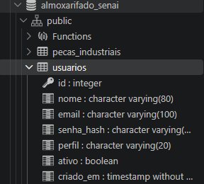

# Situação de Aprendizagem Usando Sessão , Cookie e Autenticação

## Estrutura do Projeto

Organize sua pasta extamento com a seguinte árvores de arquivos

```text
SAAutenticacao/
├── config/
│   └── database.ini        <- Credenciais protegidas de acesso ao PostgreSQL
├── logs/
│   └── database.log        <- Logs do Banco de Dados
├── src/
│   ├── ConexaoBanco.php    <- Conexão Singleton PDO com PostgreSQL
│   ├── UsuarioDAO.php      <- Camada de persistência para consulta e cadastro
│   ├── AuthService.php     <- Serviço de gerenciamento de sessão e expiração
│   └── guard.php           <- Middleware interceptador de páginas restritas
├── schema.sql              <- Estrutura da tabela de usuários corporativos
├── login.php               <- Tela de autenticação pública
├── dashboard.php           <- Painel restrito protegido
├── logout.php              <- Encerramento seguro de sessão
├── cadastro.php            <- Página de Cadastro de Usuários
├── .gitignore              <- Arquivos não Versionados
└── README.md               <- Documentação do Projeto
```

## Criação da Tabela no Banco de Dados(PostgreSQL)

```sql
-- Criação da tabela devera ser dentro do banco almoxarifado_senai

CREATE TABLE IF NOT EXISTS usuarios (
    id SERIAL PRIMARY KEY,
    nome VARCHAR(80) NOT NULL,
    email VARCHAR(100) NOT NULL UNIQUE,
    senha_hash VARCHAR(255) NOT NULL,
    perfil VARCHAR(20) NOT NULL DEFAULT 'OPERADOR' CHECK (perfil IN ('ADMIN', 'OPERADOR')),
    ativo BOOLEAN NOT NULL DEFAULT TRUE,
    criado_em TIMESTAMP WITHOUT TIME ZONE DEFAULT CURRENT_TIMESTAMP
);

```


## Configurar os Dados do Banco e Criar a Conexão Singleton

Configurar os Dados do Banco de Dados (`config/datbase.ini`)

```ini
; config/database.ini
[database]
db_driver   = pgsql
db_host     = 127.0.0.1
db_port     = 5432
db_name     = almoxarifado_senai
db_user     = postgres
db_pass     = postgres
```

Criar a Classe de Conexão com o Banco de Dados em Formato Singleton (`src/ConexaoBanco.php`)

```php
<?php
declare(strict_types=1);

/**
 * Conexao Singleton com o PostgreSQL via PDO.
 */
final class ConexaoBanco {
    private static ?PDO $instancia = null;

    private function __construct() {}
    private function __clone(): void {}

    public function __wakeup(): void {
        throw new \Exception("Desserializacao proibida.");
    }

    public static function obterConexao(string $caminhoConfig): PDO {
        if (self::$instancia === null) {
            if(!file_exists($caminhoConfig)){
                throw new \RuntimeException("Arquivo de configuração não encontrado em {$caminhoConfig}");
            }
            $dados = parse_ini_file($caminhoConfig, true);
            if($dados === false || !isset($caminhoConfig, true)){
                throw new \RuntimeException("sessão [database] ausente no arquivo de configuracao");
            }
            $cfg = $dados['database'];
            $dsn = sprintf("%s:host=%s;port=%s;dbname=%s",
                $cfg['db_driver'], $cfg['db_host'], $cfg['db_port'], $cfg['db_name']);
            self::$instancia = new PDO($dsn, $cfg['db_user'], $cfg['db_pass'], [
                PDO::ATTR_ERRMODE            => PDO::ERRMODE_EXCEPTION,
                PDO::ATTR_DEFAULT_FETCH_MODE => PDO::FETCH_ASSOC,
                PDO::ATTR_EMULATE_PREPARES   => false
            ]);
        }
        return self::$instancia;
    }
}
```

## Camada de Acesso a Dados ( `src/UsuarioDAO.php`)

Isolar as operações de busca e cadastro de usuários, aplicando o hashing de senha com `password_hash()`

criar os métodos: 
- Cadastrar (Create)
- busca por email (Read)
- Verificar se email já existe (Read)

## Fazer o Serviço de Autenticação (`src/AuthService.php`)

classe que ira criar o ciclo de vida da sessão do usuário: cookies(navegador) e as sessão(servidor)

> obs: classe tipo static (não existe instnaciamento de objetos)

AuthService.php
- iniciarSessaoSegura() => passa as informações para cookies
- autenticar() -> passa as informações para a superglobal
- sessaoExpirada() => verifica o tempo de inatividade
- sessionDestroy() => finaliza a sessão e limpas os cookies do navegador

## Middleware Interceptador (`src/guard.php`)

bloqueia visitantes não autenticados ou sessões expiradas em páginas internas

- verifica os estado da sessão
- verifica se a sessão não expirou

## Criar as Telas

### Tela de Cadastro (`cadastro.php`)

### Tela de Login (`login.php`)

### Tela de Dashboard (`dashboard.php`)

### Campo de logout (`logout.php`)


## Teste

1. Inicie o servidor embutido do PHP:
   ```bash
   php -S localhost:8000
   ```
2. **Teste 1 — Cadastro de Novo Usuário:**
   Acesse `http://localhost:8000/cadastro.php`, cadastre um novo colaborador (ex.: `maria@senai.br`) com senha de no mínimo 8 caracteres.  
   *Resultado Esperado:* O usuário é registrado no PostgreSQL com hash Argon2id e redirecionado para `login.php?sucesso=cadastrado` com feedback visual em verde.
3. **Teste 2 — Autenticação do Usuário Recém-Cadastrado:**
   Faça login utilizando as novas credenciais criadas.  
   *Resultado Esperado:* Acesso concedido com sucesso ao painel `dashboard.php`, exibindo o nome e o perfil `OPERADOR`.
4. **Teste 3 — Acesso Direto não Autenticado:**
   Abra uma aba anônima e tente digitar diretamente: `http://localhost:8000/dashboard.php`.  
   *Resultado Esperado:* O `guard.php` intercepta a requisição e o expulsa para `login.php?erro=restrito`.
5. **Teste 4 — Inspeção de Flags no DevTools:**
   No painel autenticado, abra o DevTools (**F12**) ➔ Aba **Application (ou Armazenamento)** ➔ **Cookies** ➔ `http://localhost:8000`.  
   *Resultado Esperado:* O cookie `PHPSESSID` exibirá a coluna **HttpOnly** marcada com `✔` e **SameSite** configurado como `Lax`.
6. **Teste 5 — Proteção contra Roubo via Console JavaScript:**
   No console do DevTools (**F12 ➔ Console**), digite: `console.log(document.cookie)`.  
   *Resultado Esperado:* Uma string vazia `""`! A flag `HttpOnly` impediu com sucesso que o JavaScript lesse o token de sessão!
7. **Teste 6 — Encerramento Seguro:**
   Clique no botão **Sair do Sistema**.  
   *Resultado Esperado:* O array `$_SESSION` é limpo no servidor, o cookie é destruído com timestamp expirado e a página redireciona para a tela de login.


